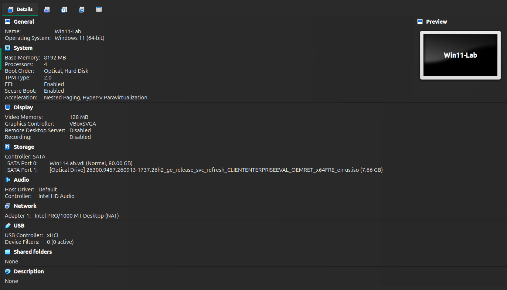
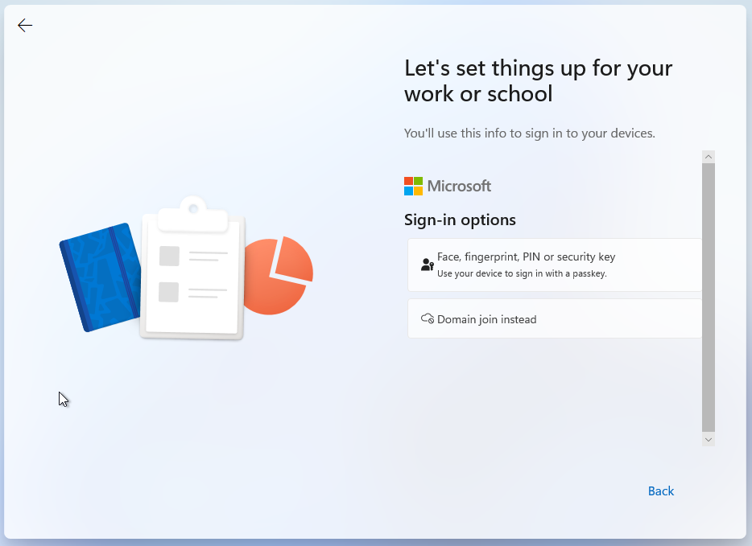
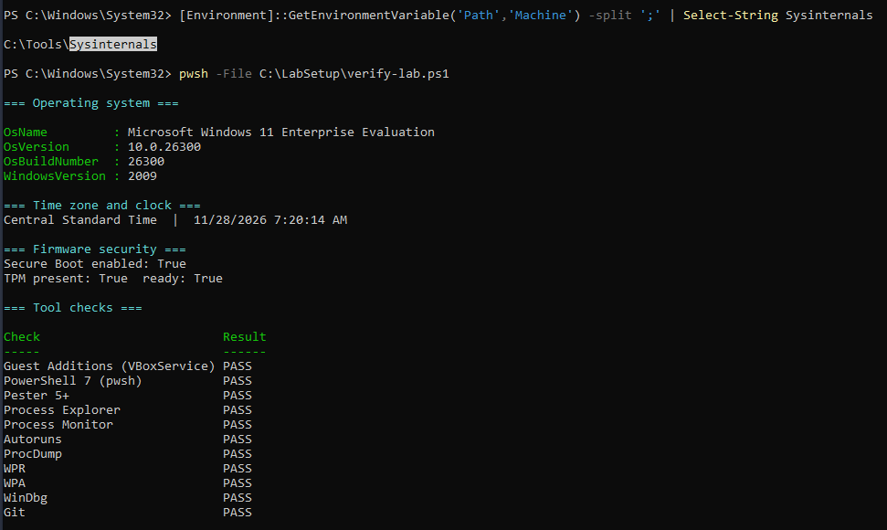

# Project 0: Build a Free Windows Support Lab

> **Status:** In progress

Build a disposable Windows 11 Enterprise evaluation VM in VirtualBox, install the free Microsoft diagnostics toolset with one script, and save a clean `baseline` snapshot that every other project in this repo starts from.

**Tools:** Windows 11 Enterprise evaluation, VirtualBox 7.2, winget, Sysinternals Suite, Windows Performance Toolkit, WinDbg, PowerShell 7, Pester
**Host used in this tutorial:** Ubuntu 24.04 LTS (kernel 7.0), Intel Core i7-10700, 16 GB RAM, NVMe SSD
**Estimated time:** 2–3 hours, most of it waiting on downloads, Windows Setup, and updates

## What you'll learn

- How to check a host for hardware virtualization, RAM, disk, and hypervisor conflicts before you build anything.
- Why Windows 11 requires UEFI, Secure Boot, and TPM 2.0, and how to give a VM all three in VirtualBox.
- How to install Windows 11 Enterprise with a local account, then install the full support toolset in one scripted step with `winget`.
- How to capture a clean `baseline` snapshot and restore it, so every lab starts from the same known-good state.

## Prerequisites

Everything in this repo is free and public.

### Hardware

| | Minimum | Recommended |
|---|---|---|
| CPU | 64-bit x86 with virtualization (Intel VT-x / AMD-V) turned on in BIOS/UEFI | 4+ cores |
| RAM | 8 GB (run one VM at a time) | 16 GB (Windows 11 + Windows Server together) |
| Disk | 100 GB free | 150 GB SSD |

Apple Silicon Macs (M1–M4) can't run the x86 evaluation images. Use a separate x86 PC, or the optional Azure path.

### Hypervisor

| Option | Host OS | Notes |
|---|---|---|
| **VirtualBox 7.2** (used in this tutorial) | Windows, Linux, Intel Mac | Free and cross-platform. |
| **Hyper-V** | Windows 10/11 Pro, Enterprise, Education | Built in. Recommended for Project 6 (WSL) because nested virtualization is reliable. |

### Operating systems (Microsoft Evaluation Center, free registration)

| Image | Evaluation length | Used in |
|---|---|---|
| Windows 11 Enterprise evaluation | 90 days | Projects 0–4, 6, 7 |
| Windows Server 2025 evaluation | 180 days | Project 5 |

Evaluations can't be activated or converted to a retail license. When one expires, rebuild from the ISO by following this tutorial again.

### Things that could cost money

| Step | Risk | How to stay at $0 |
|---|---|---|
| Optional Azure VMs | Charges after free credit or trial ends; sign-up needs a credit card | Set a $1 budget alert, deallocate VMs, delete the resource group |
| VirtualBox Extension Pack | Separate non-free license (PUEL) for some uses | Not needed. EFI, TPM 2.0, and Secure Boot are built into VirtualBox |
| Windows licenses | Evaluations expire | Rebuild from the ISO; never commit a license key |

## Scenario

> **Ticket:** "Our support team needs a safe, disposable Windows 11 endpoint where engineers can reproduce customer issues (crashing apps, slow boots, memory leaks) without risking a production machine. It must cost nothing, match what enterprise customers run, have the standard Microsoft diagnostics tools ready, and be resettable to a clean state in under a minute."

---

## Step 1: Check the host

Before installing anything, confirm the host can run a Windows 11 VM.

**On a Linux host**, run:

```bash
echo "== OS ==";                  lsb_release -ds; uname -r
echo "== CPU ==";                 lscpu | grep -E 'Model name|^CPU\(s\)|Virtualization'
echo "== VT-x/AMD-V flags ==";    egrep -c '(vmx|svm)' /proc/cpuinfo
echo "== RAM ==";                 free -h
echo "== Free disk (home) ==";    df -h ~
echo "== Disk type (0 = SSD) =="; lsblk -d -o NAME,ROTA,SIZE,MODEL
echo "== KVM modules loaded ==";  lsmod | grep -i kvm || echo "none"
echo "== Host Secure Boot ==";    mokutil --sb-state 2>/dev/null || echo "mokutil not installed"
```

**On a Windows host**, open Task Manager (`Ctrl+Shift+Esc`) → **Performance** → **CPU** and look for **Virtualization: Enabled**. Then check whether Hyper-V is active (it can slow down or block VirtualBox):

```powershell
Get-CimInstance Win32_ComputerSystem | Select-Object HypervisorPresent
bcdedit /enum | Select-String hypervisorlaunchtype
```

**What you should see** (Linux example from this build):

```text
== OS ==
Ubuntu 24.04.5 LTS
7.0.0-44-generic
== CPU ==
CPU(s):           16
Model name:       Intel(R) Core(TM) i7-10700 CPU @ 2.90GHz
Virtualization:   VT-x
== VT-x/AMD-V flags ==
32
== RAM ==
Mem:   15Gi total   9.6Gi available
== Free disk (home) ==
/dev/nvme0n1p2  468G  173G  271G  40% /
== KVM modules loaded ==
kvm_intel  536576  0
kvm       1511424  1 kvm_intel
== Host Secure Boot ==
SecureBoot disabled
```

**What it tells you:**

| Line | Meaning |
|---|---|
| VT-x/AMD-V flags > 0 | Hardware virtualization is on. If it's `0`, turn on Intel VT-x / AMD SVM in BIOS/UEFI. |
| RAM available ≥ 9 GB | Enough for an 8 GB VM. Close browsers and other heavy apps while the VM runs. |
| `ROTA 0` on your main disk | It's an SSD. Windows on a spinning disk works, but it's slow. |
| KVM modules loaded | KVM can hold VT-x and stop VirtualBox from starting VMs. See [Troubleshooting](#troubleshooting-this-lab). |
| Host Secure Boot enabled | VirtualBox's kernel modules must be signed (MOK enrollment) before they load. |

## Step 2: Install VirtualBox

Install VirtualBox from **Oracle's repository**, not Ubuntu's `virtualbox` package. Ubuntu's build is older and often can't compile its kernel module against newer kernels.

1. Check for an existing install. If anything is listed, remove it first (see [Troubleshooting](#troubleshooting-this-lab)):

   ```bash
   dpkg -l | grep -i virtualbox
   ```

2. Install the build tools and kernel headers the VirtualBox kernel module needs:

   ```bash
   sudo apt update
   sudo apt install -y wget gpg build-essential dkms linux-headers-$(uname -r)
   ```

3. Add Oracle's signing key and repository:

   ```bash
   wget -O- https://www.virtualbox.org/download/oracle_vbox_2016.asc | sudo gpg --dearmor --yes -o /usr/share/keyrings/oracle-virtualbox-2016.gpg
   echo "deb [arch=amd64 signed-by=/usr/share/keyrings/oracle-virtualbox-2016.gpg] https://download.virtualbox.org/virtualbox/debian $(lsb_release -cs) contrib" | sudo tee /etc/apt/sources.list.d/virtualbox.list
   sudo apt update
   ```

4. Install the newest 7.x release:

   ```bash
   apt-cache search '^virtualbox-7'
   sudo apt install -y virtualbox-7.2
   ```

5. Add your user to the `vboxusers` group, then **log out and back in**:

   ```bash
   sudo usermod -aG vboxusers $USER
   ```

6. Verify:

   ```bash
   VBoxManage --version
   systemctl status vboxdrv --no-pager
   lsmod | grep vbox
   ```

**What you should see:**

```text
7.2.22r175245
● vboxdrv.service - VirtualBox Linux kernel module
     Active: active (exited)
vboxnetadp             28672  0
vboxnetflt             40960  0
vboxdrv               720896  2 vboxnetadp,vboxnetflt
```

**What it tells you:** `vboxdrv` is VirtualBox's kernel driver. If it's not loaded, VirtualBox opens but can't start any VM.

Windows and macOS hosts: download the installer from <https://www.virtualbox.org/wiki/Downloads> and accept the defaults.

You don't need the Extension Pack for this lab.

## Step 3: Download the Windows 11 Enterprise evaluation ISO

1. Go to the [Windows 11 Enterprise evaluation](https://www.microsoft.com/en-us/evalcenter/download-windows-11-enterprise) page on the Microsoft Evaluation Center.
2. Fill in the free registration form.
3. Choose **ISO – Enterprise**, **64-bit**, your language. Don't pick the LTSC or Azure options.
4. Confirm you have the right image. The file name contains `CLIENTENTERPRISEEVAL`, for example:

   ```text
   26300.9457.260913-1737.26h2_ge_release_svc_refresh_CLIENTENTERPRISEEVAL_OEMRET_x64FRE_en-us.iso
   ```

5. (Recommended) Verify the download against the SHA-256 hash on the download page:

   ```bash
   sha256sum ~/Downloads/*CLIENTENTERPRISEEVAL*.iso
   ```

**Why Enterprise and not the consumer ISO?** The consumer ISO (for example `Win11_25H2_English_x64.iso`) installs Home or Pro and asks for a product key. The Enterprise evaluation is free for 90 days without a key and includes the features enterprise customers use, like AppLocker, Credential Guard, and full Group Policy.

## Step 4: Create the VM

1. Open VirtualBox → **Machine → New**.
   - **Name:** `Win11-Lab`
   - **ISO Image:** select the Windows 11 ISO. VirtualBox detects **Windows 11 (64-bit)**.
   - **Uncheck** unattended installation. You'll install manually so you can see each setup screen.
2. **Hardware:** Base Memory **8192 MB**, Processors **4**, **Use EFI** checked.
3. **Hard disk:** create a **80 GB** VDI. Leave **Pre-allocate Full Size** unchecked.
4. Click **Finish**, then open **Settings** and confirm:
   - **System → Motherboard:** TPM **v2.0**, **Enable Secure Boot** checked, boot order Optical then Hard Disk
   - **Display → Screen:** Video Memory **128 MB**, Graphics Controller **VBoxSVGA**
   - **Network → Adapter 1:** **NAT**

The New VM wizard can keep its defaults (2 CPUs, 4096 MB) even after you change them. Check the **Details** pane, and if it's wrong, fix it from the host with the VM powered off:

```bash
VBoxManage modifyvm Win11-Lab --memory 8192 --cpus 4 --boot1 dvd --boot2 disk --boot3 none --boot4 none
```

**What you should see:**



**Why Windows 11 needs each setting:**

| Setting | Why |
|---|---|
| **UEFI** | Replaces legacy BIOS. Required for Secure Boot and for booting from GPT disks. |
| **Secure Boot** | Firmware checks that the boot loader is signed by a trusted key, which blocks bootkits and rootkits that load before Windows. |
| **TPM 2.0** | A security chip (virtual here) that stores keys for BitLocker, Windows Hello, and Measured Boot. |
| **4 vCPU / 8 GB / 80 GB** | Windows 11 needs 2 cores, 4 GB, and 64 GB. Extra room keeps WPR traces and memory dumps from later projects from starving the VM. |

Without TPM 2.0 or Secure Boot, Windows Setup stops with **"This PC can't run Windows 11"**.

## Step 5: Install Windows 11

1. Select `Win11-Lab` → **Start**. When **"Press any key to boot from CD or DVD…"** appears, click inside the VM window and press a key. You have about five seconds.
2. Choose language and keyboard → **Install Windows 11** → accept the license.
3. Select **Drive 0 Unallocated Space** → **Next** → **Install**. The VM restarts several times. Don't press a key at the boot prompt again.
4. Out-of-box experience (OOBE): choose region and keyboard. When asked how to set up the device, choose **Set up for work or school** → **Sign-in options** → **Domain join instead**.

   

   **Why a local account:** it keeps a personal Microsoft account (and its email address) out of a VM you'll break on purpose and screenshot, and every reader ends up with the same `labadmin` account. Enterprise PCs use domain or Entra ID accounts, not consumer Microsoft accounts; Project 5 joins this VM to a real AD domain.

5. Create the account:
   - **User name:** `labadmin`
   - **Password and security questions:** lab-only values. Never reuse a real password.
6. On the privacy screens, turn every option **off**. If you miss them, change them later in **Settings → Privacy & security** (Diagnostics & feedback, General, Location, Inking & typing, Tailored experiences). Fewer background services means less noise in later Process Monitor and WPR traces.

<!-- TODO screenshots: boot prompt, disk selection, desktop -->

## Step 6: Install Guest Additions, set the clock, and patch

### Guest Additions

Guest Additions are VirtualBox's drivers and services for the guest OS: a display driver that resizes with the window, seamless mouse, shared clipboard, and time sync.

1. In the VM window's menu, click **Devices → Insert Guest Additions CD image…**
2. In Windows, open **File Explorer → This PC → CD Drive (D:) VirtualBox Guest Additions** and run **VBoxWindowsAdditions.exe**.
3. Keep the default components. When Windows asks to install device software from Oracle, click **Install**.
4. Choose **Reboot now** → **Finish**.
5. In the VM menu, set **Devices → Shared Clipboard → Bidirectional** and turn on **View → Auto-resize Guest Display**.
6. Verify in PowerShell inside the VM:

   ```powershell
   Get-Service VBoxService
   Get-CimInstance Win32_VideoController | Select-Object Name
   ```

   **What you should see:** `VBoxService` is **Running**, and the video controller is **VirtualBox Graphics Adapter (WDDM)**.

### Time zone

Every later project compares timestamps across event logs, Perfmon, and traces, so set the correct time zone now. In an elevated PowerShell window (use your own time zone ID; `Get-TimeZone -ListAvailable` lists them):

```powershell
Set-TimeZone -Id 'Central Standard Time'
w32tm /resync
Get-Date
```

### Windows Update

1. **Settings → Windows Update → Check for updates.** Install everything and restart until it says **You're up to date**. This can take 20–40 minutes.
2. Click **Pause updates → Pause for 5 weeks**.

**Why pause:** if updates download in the middle of a lab, `TiWorker.exe` and the update services spike CPU, disk, and network and pollute your Perfmon and WPR data. Every project restores to `baseline`, so the lab stays at one patch level.

<!-- TODO screenshots: Guest Additions installer, Windows Update up to date + paused -->

## Step 7: Install the toolset

[`scripts/install-tools.ps1`](scripts/install-tools.ps1) installs everything in one run:

| Tool | winget ID | Used in |
|---|---|---|
| PowerShell 7 | `Microsoft.PowerShell` | Projects 4, 6, 8 |
| Sysinternals Suite (Process Explorer, Process Monitor, Autoruns, ProcDump) | Zip from `download.sysinternals.com` to `C:\Tools\Sysinternals`, added to `PATH` | Projects 1, 2, 8 |
| WinDbg | `Microsoft.WinDbg` | Projects 2, 8 |
| Git | `Git.Git` | All |
| Windows Performance Toolkit (WPR, WPA) from the Windows ADK | `Microsoft.WindowsADK` (WPT feature only) | Project 3 |
| Pester | PowerShell Gallery | Project 4 |

1. Right-click **Start → Terminal (Admin)** and click **Yes** at the UAC prompt.
2. Create a working folder and open Notepad **from this elevated window**:

   ```powershell
   New-Item -ItemType Directory -Path C:\LabSetup -Force
   notepad C:\LabSetup\install-tools.ps1
   ```

   Paste the contents of [`scripts/install-tools.ps1`](scripts/install-tools.ps1) and press `Ctrl+S`. (Or download it directly; see the note below.)

3. Confirm the file name is exactly `install-tools.ps1`, not `install-tools.ps1.txt`:

   ```powershell
   Get-ChildItem C:\LabSetup
   ```

4. Run it:

   ```powershell
   Set-ExecutionPolicy -Scope Process -ExecutionPolicy Bypass -Force
   cd C:\LabSetup
   .\install-tools.ps1
   ```

**Download instead of pasting** (PowerShell, inside the VM):

```powershell
New-Item -ItemType Directory -Path C:\LabSetup -Force
Invoke-WebRequest https://raw.githubusercontent.com/ldwit/windows-enterprise-support-engineering/main/00-lab-environment/scripts/install-tools.ps1 -OutFile C:\LabSetup\install-tools.ps1
```

**What you should see:** after 10–20 minutes, a summary table with every package **Installed** (or **Already installed** on a re-run). A full transcript is saved in `C:\LabLogs\`.

<!-- TODO: paste real summary output + screenshot -->

Close the terminal and open a new one so the new tools are on your `PATH`.

## Step 8: Verify the lab

[`scripts/verify-lab.ps1`](scripts/verify-lab.ps1) checks the OS, time zone, Secure Boot, TPM, Guest Additions, and every tool.

1. Close every terminal window, then open a new **Terminal (Admin)**. New windows pick up the `PATH` changes from Step 7.
2. Save the script to `C:\LabSetup\verify-lab.ps1` (the same way as Step 7) and run it with PowerShell 7, so the Pester check sees modules installed for your user:

   ```powershell
   pwsh -File C:\LabSetup\verify-lab.ps1
   winver
   ```

**What you should see:**

```text
=== Operating system ===
OsName         : Microsoft Windows 11 Enterprise Evaluation
OsVersion      : 10.0.26300
OsBuildNumber  : 26300

=== Time zone and clock ===
Central Standard Time  |  11/28/2026 7:20:14 AM

=== Firmware security ===
Secure Boot enabled: True
TPM present: True  ready: True

=== Tool checks ===
Check                         Result
-----                         ------
Guest Additions (VBoxService) PASS
PowerShell 7 (pwsh)           PASS
Pester 5+                     PASS
Process Explorer              PASS
Process Monitor               PASS
Autoruns                      PASS
ProcDump                      PASS
WPR                           PASS
WPA                           PASS
WinDbg                        PASS
Git                           PASS
```



**What it tells you:** Windows sees the virtual TPM and Secure Boot you set in Step 4, the clock matches your time zone, and every tool the later projects use is installed and on `PATH`. Fix any **FAIL** before you take the snapshot. See [Troubleshooting](#troubleshooting-this-lab).

3. Launch each tool once to accept its EULA and dismiss first-run prompts, then close it: `procexp64`, `procmon64` (click **Cancel** on the filter dialog), `autoruns64`, `WinDbgX`, and **Windows Performance Analyzer** from the Start menu.

## Step 9: Take the `baseline` snapshot

<!-- TODO -->

---

## Troubleshooting this lab

| Symptom | Likely cause | What to do |
|---|---|---|
| `egrep -c '(vmx\|svm)' /proc/cpuinfo` returns `0`, or Task Manager shows **Virtualization: Disabled** | Intel VT-x / AMD SVM is off in firmware | Reboot into BIOS/UEFI setup and turn on **Intel Virtualization Technology** or **SVM Mode**. |
| `VBoxManage --version` prints **"WARNING: The vboxdrv kernel module is not loaded"**, and `systemctl status vboxdrv` shows **failed** | The installed VirtualBox is too old to build its kernel module for your kernel. In this build, VirtualBox **7.0.26** on kernel **7.0** failed with `fatal error: VBox/cdefs.h: No such file or directory` in `/var/log/vbox-setup.log`. | Check `dpkg -l \| grep -i virtualbox` and `sudo tail -n 40 /var/log/vbox-setup.log`. Remove the old package, install the current one, rebuild: `sudo apt remove --purge -y virtualbox-7.0 && sudo apt install -y virtualbox-7.2 && sudo /sbin/vboxconfig`. Existing VMs in `~/VirtualBox VMs` are kept. |
| vboxdrv fails to load with a key or signature error | Host Secure Boot is on and the module isn't signed | Run `sudo /sbin/vboxconfig` and follow the MOK enrollment prompt, then reboot and enroll the key. |
| VM won't start: `VERR_VMX_IN_VMX_ROOT_MODE` or "VT-x is being used by another hypervisor" (Linux) | KVM holds VT-x | Unload KVM until next reboot: `sudo modprobe -r kvm_intel kvm` (`kvm_amd` on AMD). |
| VM is very slow, or shows a turtle icon (Windows host) | Hyper-V, WSL 2, or Memory Integrity is active, so VirtualBox runs on top of Windows Hypervisor Platform | Use Hyper-V for the lab instead, or turn off Hyper-V with `bcdedit /set hypervisorlaunchtype off` and reboot (this also stops WSL 2). |
| "This PC can't run Windows 11" during Setup | TPM 2.0 or Secure Boot isn't enabled, or EFI is off | **Settings → System → Motherboard:** TPM v2.0, Enable Secure Boot, and EFI on. |
| VM lands at a UEFI shell or "No bootable device" | You missed the "Press any key to boot from CD or DVD" prompt, or no ISO is attached | **Machine → Reset**, then press a key quickly. Check **Settings → Storage** for the ISO. |
| VM shows 4096 MB / 2 CPUs after you chose more in the wizard | Wizard kept its defaults | Power off, then `VBoxManage modifyvm Win11-Lab --memory 8192 --cpus 4`. |
| No "Domain join instead" option in OOBE | Different OOBE flow | Press `Shift+F10` and run `start ms-cxh:localonly` to create a local account. |
| "You don't have permission to save in this location" when saving to `C:\` | Notepad isn't elevated. With UAC, even an admin account runs as a standard user until elevated, and standard users can't create files in the root of `C:\`. | Open Notepad from an elevated terminal, or save to a folder you created. **Don't change permissions on `C:\`.** |
| An **"Account Unknown (S-1-15-3-…)"** entry on the `C:\` Security tab | Capability SID for sandboxed (AppContainer) apps. Windows can't resolve it to a name. | Normal. Leave it alone. |
| `.\install-tools.ps1` "is not recognized" | Notepad saved it as `install-tools.ps1.txt` | `Rename-Item C:\LabSetup\install-tools.ps1.txt install-tools.ps1`. Turn on **File Explorer → View → Show → File name extensions**. |
| File timestamps in the VM are hours off | VM time zone is wrong | `Set-TimeZone -Id '<your zone>'; w32tm /resync` |
| "running scripts is disabled on this system" | Default execution policy | `Set-ExecutionPolicy -Scope Process -ExecutionPolicy Bypass -Force` (this window only). |
| Sysinternals install fails: **"The requested operation is not permitted from an administrator context on packages installed within the user scope"** (exit code `-1978335107`) | The winget `Microsoft.Sysinternals.Suite` package is a per-user package, and winget won't install per-user packages from an elevated window | The script downloads the official zip to `C:\Tools\Sysinternals` instead. Run the current version of `install-tools.ps1`. |
| Pester shows **SKIPPED (pwsh.exe not found)** | PowerShell 7 was just installed, and the current window can't see it yet | Open a new elevated window and run the script again. Installed packages are skipped. |
| `verify-lab.ps1` shows **FAIL** for Process Explorer, Process Monitor, Autoruns, and ProcDump, but `Test-Path C:\Tools\Sysinternals\procexp64.exe` is `True` | The terminal was opened before `C:\Tools\Sysinternals` was added to the machine `PATH`. A process keeps the environment it started with, and so do its children (like `pwsh`). | Close every terminal window, open a new one, and run the check again. |
| Time zone shows the wrong region (for example **China Standard Time**) after setup | The region chosen during setup, or a default from the ISO | `Set-TimeZone -Id '<your zone>'; w32tm /resync`. Run `Start-Service w32time` first if `w32tm` says the service isn't running. |
| `winget` not found | App Installer is out of date | Microsoft Store → **Library → Get updates**, or update **App Installer**. |

## Clean up and reset

Restore the VM to the `baseline` snapshot. See Step 9.

When the 90-day evaluation expires, delete the VM (**Machine → Remove → Delete all files**) and repeat this tutorial from Step 4.

## Further reading

- [Windows 11 system requirements](https://learn.microsoft.com/windows/whats-new/windows-11-requirements)
- [Trusted Platform Module overview](https://learn.microsoft.com/windows/security/hardware-security/tpm/trusted-platform-module-overview)
- [Secure the Windows boot process](https://learn.microsoft.com/windows/security/operating-system-security/system-security/secure-the-windows-10-boot-process)
- [Use WinGet to install and manage applications](https://learn.microsoft.com/windows/package-manager/winget/)
- [Sysinternals](https://learn.microsoft.com/sysinternals/)
- [Windows Performance Toolkit](https://learn.microsoft.com/windows-hardware/test/wpt/)
- [Install WinDbg](https://learn.microsoft.com/windows-hardware/drivers/debugger/)
- [Installing PowerShell on Windows](https://learn.microsoft.com/powershell/scripting/install/installing-powershell-on-windows)
- [VirtualBox User Manual](https://www.virtualbox.org/manual/)
